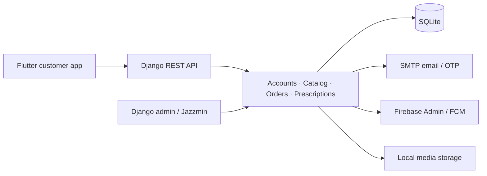

# Mahmood Pharmacy · Backend

A Django REST backend for a pharmacy storefront: product discovery, customer accounts, orders, prescription uploads, branch data, and notifications. A customized Django admin supports management workflows.

**Python · Django 5.1 · Django REST Framework · Simple JWT · SQLite · Firebase Admin**

[Get started](docs/SETUP.md) · [API overview](docs/API.md) · [Customer app](https://github.com/Imranxhah/MAHMOOD_PHARMACY_CUSTOMER_APP) · [Contribute](CONTRIBUTING.md)

## What is included

| Module | Responsibility |
| --- | --- |
| `users` | Email-based accounts, OTP verification, JWT login, profiles, and addresses |
| `products` | Categories, catalog search/filtering, favorites, and product imports |
| `orders` | Checkout, cart validation, delivery charges, and order-status workflows |
| `prescriptions` | Prescription uploads and review records |
| `branches` | Branch records and nearest-branch lookup |
| `marketing` | Banners and notification sending |
| `notifications` | Notification records and Firebase messaging integration |
| `analytics` | Dashboard statistics, charts, and reports |

The implementation uses a local SQLite database by default. Throughput, production capacity, and delivery-tracking accuracy have not been established by benchmarks in this repository.

## Get started

Use **Python 3.11 or 3.12** and a virtual environment.

```bash
git clone https://github.com/Imranxhah/MAHMOOD_PHARMACY_BACKEND.git
cd MAHMOOD_PHARMACY_BACKEND
python -m venv .venv
```

Activate it:

```powershell
# Windows PowerShell
.\.venv\Scripts\Activate.ps1
```

```bash
# macOS / Linux
source .venv/bin/activate
```

Then install dependencies and configure your local environment:

```bash
python -m pip install -r requirements.txt
```

Copy `.env.example` to `.env` and follow the [setup guide](docs/SETUP.md) before starting. In particular, use a **fresh development database** rather than the tracked database snapshot.

```bash
python manage.py migrate
python manage.py createsuperuser
python manage.py runserver
```

Open [the local admin](http://127.0.0.1:8000/admin/) or request [the product catalog](http://127.0.0.1:8000/api/products/).

## Architecture



## Documentation

| Guide | Use it for |
| --- | --- |
| [Local setup](docs/SETUP.md) | Environment, database isolation, Firebase, and troubleshooting |
| [API overview](docs/API.md) | Route groups and copyable request examples |
| [Flutter integration](flutter_api_guide.md) | Existing client integration notes |
| [Prescription API](prescriptions_api_guide.md) | Existing upload and prescription workflow notes |
| [Notifications API](notifications_api_guide.md) | Notification client integration |
| [Firebase setup](firebase_setup_guide.md) | Existing Firebase configuration notes |
| [Product search](product_search_guide.md) | Existing search notes |
| [Notification design](notification_system_design.md) | Existing implementation/design notes |

Older guides may describe a different revision. The URL configuration, views, and serializers are authoritative when examples differ.

## Development and deployment status

`python manage.py check` checks Django configuration. The application test files are mostly scaffolding; they do not establish end-to-end coverage.

The current settings enable debug mode, permissive CORS, and a source-defined Django secret key. Configure these explicitly before deployment. SMTP and Firebase are external integrations, and user-uploaded files need an appropriate access and retention policy. See [setup notes](docs/SETUP.md).

The cover is illustrative artwork. No production uptime or scale is implied.

## Contributing

See [CONTRIBUTING.md](CONTRIBUTING.md). Use synthetic data in examples, tests, and screenshots.

No license file is included. Contact the owner to clarify reuse terms.

Built by [Imran Shah](https://github.com/Imranxhah).
